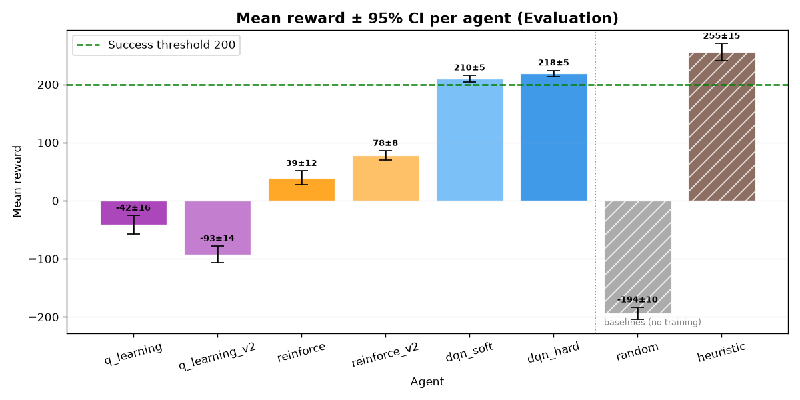

# LunarLander RL

Five reinforcement learning approaches compared on Gymnasium's **LunarLander-v3**: land a
lunar module on its pad, from 8 continuous observations and 4 discrete engine actions. The
task counts as solved at a mean score of 200 over 100 episodes.

A Double DQN with a hard target update solves it: **218.5 ± 5.4** over 5 training seeds,
and the best seed scores **249** with 96 landings out of 100.

[Watch the best agent land (MP4)](videos/evals/dqn_hard_seed4/full_run.mp4)



## Try it (no training needed)

The trained DQN weights are in `models/` (76 KB each, 5 seeds × 2 variants).

```bash
git clone https://github.com/Ridwane777/lunarlander-rl.git
cd lunarlander-rl
python3 -m venv venv && source venv/bin/activate
pip install -r requirements.txt          # Box2D may need swig: sudo apt install swig

python play.py                           # opens a window: 3 landings by the best agent
python play.py --record landing.gif      # or save them as a GIF / MP4
python play.py --model models/dqn_soft_seed0.pth --episodes 5 --seed 42
```

## Agents

| Agent | Category | Mode | File |
|---|---|---|---|
| Random | baseline | n/a | `src/agents/random_agent.py` |
| Heuristic | baseline (hand-written controller) | n/a | `src/agents/heuristic_agent.py` |
| Q-Learning | tabular, discretized states | off-policy | `src/agents/q_learning.py` |
| REINFORCE | policy gradient | on-policy | `src/agents/reinforce_agent.py` |
| Double DQN | value-based, replay buffer, target network | off-policy | `src/agents/dqn_agent.py` |

## Results

100 deterministic evaluation episodes per seed (seeds 10000 to 10099), 5 training seeds per
method, mean reward ± 95% confidence interval:

| Method | Mean score | Success rate | Verdict |
|---|---|---|---|
| **DQN, hard target update** | **218.5 ± 5.4** | **75.6%** | solved |
| DQN, soft target update | 210.0 ± 5.4 | 70.6% | solved |
| REINFORCE (tuned) | 77.6 ± 12.5 | 12.0% | learns, unstable |
| Q-Learning | -41.8 ± 16.1 | 18.2% | limited by the discretization |
| Random | -184.6 ± 9.6 | 0.0% | reference zero |
| Heuristic | to be re-measured | | see below |

DQN wins thanks to its replay buffer and its ability to generalize over continuous states,
where tabular Q-Learning must discretize them. The hard target update is slightly better
and as stable as the soft one.

**Heuristic baseline.** The first hand-written controller only reacted to large tilts and
fast falls and scored -219.8 ± 14.9, worse than random actions, so it was not a meaningful
reference. It has been replaced by a proportional-derivative controller adapted from the
one shipped with Gymnasium (MIT license); its score has not been measured yet.

Per-method details, hyperparameters and curves: [docs/benchmark.md](docs/benchmark.md);
design choices: [docs/optimization.md](docs/optimization.md).

## Usage

```bash
python train.py --config configs/dqn_hard.yaml   # train one agent (all seeds of its config)
python train.py                                  # train every agent
python train.py --plot-only                      # only redraw the training curves

python eval.py                                   # evaluate every model in models/, 100 episodes each
python eval.py --models models/dqn_hard_seed*.pth
python eval.py --plot-only                       # only redraw the benchmark plots

bash scripts/reproduce.sh                        # everything, from scratch
pytest tests/                                    # unit tests
```

Only the DQN weights are versioned; the Q-Learning tables (up to 8 MB per seed) and the
other models are regenerated by `train.py`.

## Project structure

```
.
├── train.py            training entry point
├── eval.py             evaluation and benchmark entry point
├── play.py             watch or record the trained agent
├── configs/            hyperparameters per algorithm (YAML)
├── src/
│   ├── agents/         the five agents
│   ├── trains/         training loops
│   ├── evals/          deterministic evaluation, metrics, plots
│   └── utils/          replay buffer, logger, statistics, videos
├── models/             shipped DQN weights (.pth)
├── tests/              unit tests (pytest)
├── logs/               training and evaluation CSV logs
├── plots/              learning curves and benchmark charts
├── videos/             training and evaluation videos
├── docs/               benchmark, design choices, report
└── scripts/            reproduce.sh, run_eval.sh
```

## Author

[Ridwane777](https://github.com/Ridwane777): architecture, agents (Q-Learning, REINFORCE,
DQN), training and evaluation pipeline, CI and benchmark.

## License

[MIT](LICENSE)
