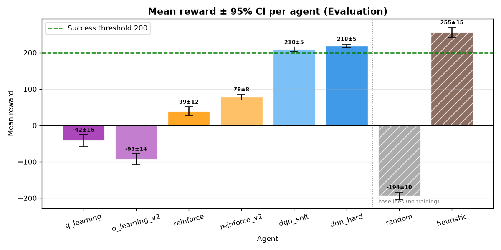
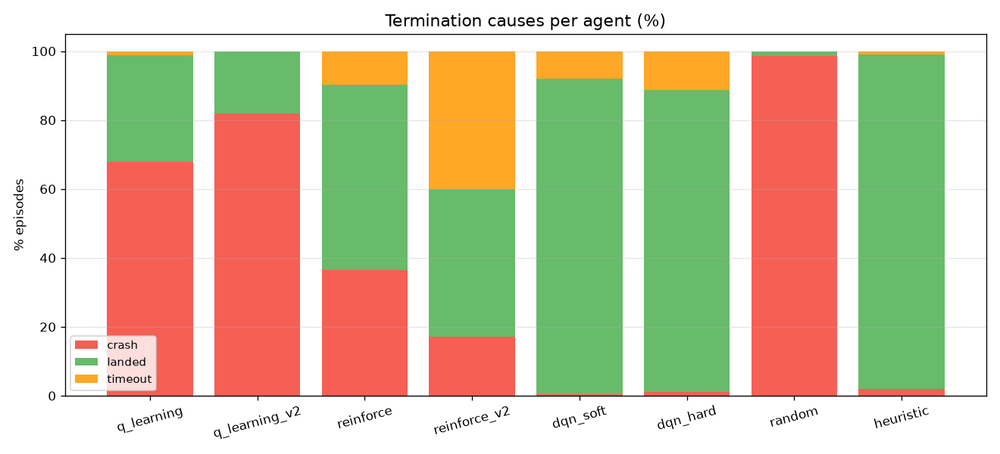

# Results

[Docs index](../README.md) · see also: [methodology](methodology.md), [limitations and next steps](limitations-and-next-steps.md)

All numbers come from the CSV files in `logs/` and are regenerated by `python eval.py`.
Evaluation: the same 100 episodes for every pilot (seeds 10000 to 10099), see
[methodology](methodology.md).

## Summary

| Pilot | Training | Eval mean ± 95% CI | Success (≥ 200) | Solved during training |
|---|---|---|---|---|
| Random actions | none | -193.9 ± 10.3 | 0.0% | n/a |
| Q-Learning (`q_learning`) | 200k steps | -41.8 ± 16.1 | 18.2% | 0 / 5 runs |
| Q-Learning (`q_learning_v2`) | 200k steps | -92.7 ± 14.4 | 11.6% | 0 / 5 |
| REINFORCE (`reinforce`) | 200k steps | 39.2 ± 11.9 | 18.2% | 0 / 5 |
| REINFORCE (`reinforce_v2`) | 200k steps | 77.6 ± 8.1 | 12.0% | 0 / 5 |
| DQN, soft target update | 210k to 283k steps | 210.0 ± 5.4 | 70.6% | 5 / 5 |
| **DQN, hard target update** | 224k to 281k steps | **218.5 ± 5.4** | **75.6%** | **5 / 5** |
| Rule-based controller | none (hand-written) | 255.4 ± 14.6 | 95.0% | n/a |

**Reading:** each learning method improves on the previous one, and only DQN learns to
land reliably from the reward alone. The hand-written controller scores higher still,
because it starts from a human understanding of the physics
([chapter 6](../theory/06-rule-based-control.md)).

## Per-seed evaluation means

Variation between training runs, which the pooled confidence interval does not show:

| Method | seed 0 | seed 1 | seed 2 | seed 3 | seed 4 |
|---|---|---|---|---|---|
| `q_learning` | -60.8 | -22.5 | -31.1 | -60.0 | -34.4 |
| `q_learning_v2` | -127.3 | -77.7 | -87.3 | -100.9 | -70.2 |
| `reinforce` | 5.2 | -26.9 | 52.3 | 127.0 | 38.3 |
| `reinforce_v2` | 73.3 | 27.6 | 106.3 | 113.8 | 66.8 |
| `dqn_soft` | 238.4 | 234.0 | 186.0 | 189.8 | 201.9 |
| `dqn_hard` | 202.0 | 212.2 | 203.7 | 225.2 | **249.2** |

## Training runs

| Method | Episodes per run | Last-100 training mean at the end |
|---|---|---|
| `q_learning` | 810 to 915 | -36.4 to -8.0 |
| `q_learning_v2` | 921 to 1031 | -112.2 to -33.7 |
| `reinforce` | 616 to 828 | 36.5 to 143.8 |
| `reinforce_v2` | 627 to 816 | 32.1 to 62.6 |
| `dqn_soft` | 393 to 560 | ≥ 200 (stopped when solved) |
| `dqn_hard` | 432 to 534 | ≥ 200 (stopped when solved) |

Learning curves for each configuration (per seed and aggregated with a 95% band) are in
`plots/<configuration>/`.

## How episodes end

- **Random actions** end almost every episode with a crash after about 90 frames.
- **Q-Learning** still crashes in about two episodes out of three.
- **REINFORCE** crashes less but often hovers until the time limit: up to 72 timeouts out
  of 100 for one `reinforce_v2` seed. Its higher mean comes partly from avoiding crashes
  rather than from landing.
- **DQN** almost never crashes (at most 5 per 100); its failures are mostly slow
  hovering descents that hit the 1000-frame limit.
- **The controller** lands in about 250 frames, half the time of the DQN agents.

The labels are approximate (see [methodology](methodology.md#caveats)); the success rate
is exact.

## Ablations

### DQN: hard versus soft target update

The only change between `dqn_hard` and `dqn_soft` is how the target network is refreshed
([chapter 5](../theory/05-dqn.md)). Hard is 8.5 points higher on the pooled mean, but the
intervals overlap and the per-seed spread (186 to 238 for soft, 202 to 249 for hard) is
larger than the gap. Conclusion: no meaningful difference on this task with 5 seeds.

### Q-Learning: learning rate and exploration

`q_learning_v2` halves the learning rate (0.1 → 0.05) and slows the ε decay (0.995 →
0.999 per step). It does worse on every seed. Because ε decays per step, exploration
lasts about 4 600 steps instead of 920 in both cases, which is still very short; the
slower learning rate is the change that matters
([chapter 3](../theory/03-q-learning.md#why-it-plateaus)).

### REINFORCE: network width and learning rate

`reinforce_v2` doubles the hidden width (128 → 256) and halves the learning rate. It
raises the mean (39 → 78) and narrows the interval, but lowers the success rate (18% →
12%): it learned to avoid crashes by hovering more, not to land better.

## Earlier hand-written controller

A first rule-based controller scored -219.8 ± 14.9 with no success, worse than random
actions, because of an inverted tilt correction. It was replaced by the current one;
the analysis is in [chapter 6](../theory/06-rule-based-control.md#a-first-version-that-failed).
