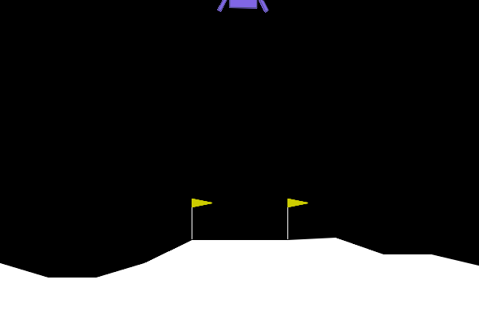

# 1. The problem: landing on the Moon

[Docs index](../README.md) · next: [RL foundations](02-rl-foundations.md)

## In one paragraph

A lunar module starts at the top of the screen with a random push. It has a main engine
under it and two small side engines. Each frame, the pilot chooses one of four actions:
do nothing, fire the left engine, fire the main engine, or fire the right engine. The goal
is to land softly on the pad between the two flags, upright, without wasting fuel. The
question this project asks is: **can a program learn to do this by trial and error alone,
without being told how the lander works?**



## The environment

`LunarLander-v3` from [Gymnasium](https://gymnasium.farama.org/environments/box2d/lunar_lander/)
(Towers et al., 2024), simulated by the Box2D physics engine at 50 frames per second.
Everything below is read from the environment source (`gymnasium/envs/box2d/lunar_lander.py`,
Gymnasium 1.4.0).

### What the pilot observes: 8 numbers

| # | Observation | Meaning |
|---|---|---|
| 0 | `x` | horizontal position, normalised; the pad is at 0, the screen edges at ±1 |
| 1 | `y` | height above the pad, normalised |
| 2 | `vx` | horizontal velocity |
| 3 | `vy` | vertical velocity (negative when falling) |
| 4 | `angle` | tilt in radians, 0 when upright |
| 5 | `angular_velocity` | rotation speed |
| 6 | `left_contact` | 1 if the left leg touches the ground, else 0 |
| 7 | `right_contact` | 1 if the right leg touches the ground, else 0 |

Six of these are **continuous**: there are infinitely many possible situations. This is
the main difficulty for the simplest learning method (see [Q-Learning](03-q-learning.md)).

### What the pilot can do: 4 actions

| Action | Effect |
|---|---|
| 0 | nothing |
| 1 | fire the left orientation engine |
| 2 | fire the main engine (push opposite to the lander's bottom) |
| 3 | fire the right orientation engine |

Engines are on or off; there is no throttle. Fuel is unlimited but costly in reward.

### How the pilot is scored: the reward

At every frame the environment returns a reward. It is built from a **shaping** term,
a measure of how good the current situation looks:

```
shaping = - 100 * distance_to_pad
          - 100 * speed
          - 100 * |angle|
          + 10 * left_contact + 10 * right_contact
```

The reward of a frame is the **change** in shaping since the previous frame, minus a fuel
cost: 0.3 per frame of main engine, 0.03 per frame of side engine. Getting closer, slower
and more level earns points; drifting away loses them. On the last frame the reward is
replaced by:

- **-100** if the body touches the ground (crash) or leaves the screen (`|x| >= 1`);
- **+100** if the lander comes to rest (Box2D puts the body to sleep).

The total over an episode is typically between -400 (fast crash) and about +300 (clean
landing). An episode **counts as a success at 200 points or more**, and the task is
considered **solved when the mean over 100 episodes reaches 200**. Episodes are cut after
1000 frames (20 seconds), which mostly catches agents that hover forever.

Rewarding progress at every frame instead of only at the end is called *reward shaping*.
It makes learning much faster, because the agent gets feedback long before it first lands.
Ng, Harada and Russell (1999) showed that shaping defined as a difference of potentials
does not change which policy is optimal; LunarLander's shaping follows that form (with no
discount on the potential).

### What makes it hard

1. **Continuous states.** A table with one entry per situation is impossible; the agent
   must generalise from situations it has seen to ones it has not.
2. **Delayed consequences.** Firing the main engine costs points now and pays off seconds
   later, when the lander does not crash. The agent has to assign credit across hundreds of
   frames.
3. **Competing goals.** Braking costs fuel; not braking risks the -100 crash. Hovering is
   safe but never ends the episode with the +100 bonus.
4. **Random starts.** The initial push and the terrain change every episode, so memorising
   one trajectory is not enough.

## Two ways to fly

This project compares two fundamentally different ways to build a pilot:

- **Learning from experience** (the core of the project). The agent starts knowing nothing
  about physics, flies thousands of episodes, and improves only from the reward. Three
  algorithms are compared: [Q-Learning](03-q-learning.md), [REINFORCE](04-reinforce.md) and
  [DQN](05-dqn.md).
- **Writing the rules by hand** ([rule-based control](06-rule-based-control.md)). An engineer
  who knows the dynamics writes a feedback controller. No training, no data, but it only
  works because a human understood the problem first.

A third pilot, choosing **random** actions, gives the score of "no skill at all".
